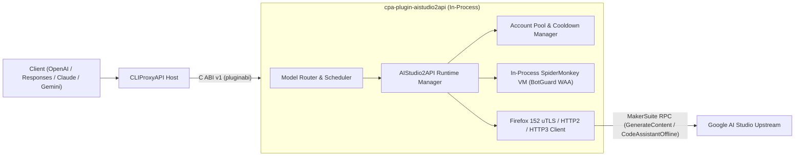

# cpa-plugin-aistudio2api (AIStudio2API for CLIProxyAPI)

<p align="center">
  <strong>简体中文</strong> | <a href="./README_EN.md">English</a>
</p>

<p align="center">
  <a href="https://github.com/Mag1cFall/AIStudio2API"></a>
  <a href="https://github.com/router-for-me/CLIProxyAPI"></a>
  <a href="./LICENSE"></a>
</p>

> **项目说明与致谢（Upstream Attribution）**  
> 本项目是将 **[Mag1cFall/AIStudio2API](https://github.com/Mag1cFall/AIStudio2API)** 完整移植为 **[CLIProxyAPI](https://github.com/router-for-me/CLIProxyAPI)** 原生动态库插件（Native C ABI v1 / Schema v10）的开源项目。  
> 核心协议栈（MakerSuite `GenerateContent`、Build `CodeAssistantOffline`、Firefox/uTLS 浏览器指纹伪装、进程内 SpiderMonkey BotGuard WAA 虚拟机、多账号冷却调度与多协议转换）均源自 **[Mag1cFall/AIStudio2API](https://github.com/Mag1cFall/AIStudio2API)**，遵循 [MIT License](./LICENSE)。

---

## 核心特性

- **进程内 SpiderMonkey BotGuard WAA 引擎**：直接将 Firefox 152 SpiderMonkey C++ 引擎静态链接进动态库（`.dylib` / `.so` / `.dll`），在 CLIProxyAPI 进程内毫秒级完成 Google BotGuard WAA 字节码解释与签名生成，无需安装 Python、Node.js、Playwright 或无头浏览器。
- **Playground + Build 双通道完整支持**：
  - **Playground 通道**（`MakerSuiteService/GenerateContent`）：支持 `gemini-3.8-flash`、`gemini-4-argon`、`gemini-2.5-pro`、`gemini-2.5-flash`、Imagen、Veo、TTS 等全部模型。
  - **Build 通道**（`MakerSuiteService/CodeAssistantOffline`）：支持 `gemini-3.8-flash-build`、`gemini-3.1-pro-preview-build` 等 `-build` 后缀模型，以及 Build 独有模型（合计自动发现 50+ 模型）。
- **四协议原生输入输出**：同时支持 `chat-completions`（OpenAI Chat）、`responses`（OpenAI Responses）、`anthropic`（Claude Messages）与 `gemini`（Google Gemini Native）请求/流式响应。
- **全套 CLIProxyAPI 插件能力接入（9 大能力）**：
  1. `auth_provider`：支持在 ECPA / CPA 控制台直接点击 **「开始登录」** 一键拉起本机独立 Chrome 窗口完成 OAuth 登录与自动轮询（`auth.login_start` / `auth.login_poll`），并 1 对 1 自动同步至 `~/.cli-proxy-api/aistudio2api-<email>.json`。
  2. `model_provider`：静态目录 + 按账户动态发现 Playground 与 Build 模型目录。
  3. `model_router`：支持 `aistudio/<model>` 前缀及无前缀模型名（如 `gemini-3.8-flash`、`gemini-3.8-flash-build`）自动路由。
  4. `scheduler`：复用 AIStudio2API 原生 `AccountPool` 权益分级（Paid / Free）、并发度与冷却感知调度。
  5. `executor`：同步/流式生成、Build 原生工具调用、Token 计数（SentencePiece + 上游 `CountTokens`）与多模态媒体透传。
  6. `request_lifecycle_plugin`：跟踪请求完成度与状态码。
  7. `quota_provider`：在 CPA 控制台实时展示账户权益等级、可用模型数与冷却恢复倒计时，支持一键重置冷却。
  8. `command_line_plugin`：扩展 `--aistudio2api-status` 与 `--aistudio2api-login` 命令行参数。
  9. `management_api` + 内置控制台页面（`/v0/resource/plugins/aistudio2api/accounts`）：提供单按钮启停控制、本机 Chrome 独立窗口登录、Cookie/StorageState 账户导入、冷却清理与实时运行日志。
---

## 架构概览



---

## 安装方式

### 方式一：通过 CLIProxyAPI 插件商店安装（推荐）
在 CLIProxyAPI 管理中心（或 EasyCLIProxyAPI 桌面端）进入 **插件（Plugins） -> 插件商店（Store）**，搜索 **`AIStudio2API`**（ID: `aistudio2api`）点击一键安装。

### 方式二：从 GitHub Releases 下载预编译包
1. 前往 [Releases](https://github.com/jianli9158/cpa-plugin-aistudio2api/releases) 下载对应平台的压缩包：
   - macOS Apple Silicon: `aistudio2api_1.1.3_darwin_arm64.zip`
   - macOS Intel: `aistudio2api_1.1.3_darwin_amd64.zip`
   - Linux x86_64: `aistudio2api_1.1.3_linux_amd64.zip`
   - Linux ARM64: `aistudio2api_1.1.3_linux_arm64.zip`
   - Windows x86_64: `aistudio2api_1.1.3_windows_amd64.zip`
2. 解压出动态库文件（`aistudio2api.dylib` / `aistudio2api.so` / `aistudio2api.dll`），放入 CLIProxyAPI 的插件目录：
   ```text
   plugins/<goos>/<goarch>/aistudio2api.{dylib,so,dll}
   ```

### 方式三：从源码构建
#### 环境要求
- Go 1.27+（需开启 `CGO_ENABLED=1`）
- C/C++ 编译器（macOS: Xcode Command Line Tools；Linux: GCC/Clang；Windows: MinGW-w64 / LLVM-MinGW）

#### 构建命令
```bash
git clone https://github.com/jianli9158/cpa-plugin-aistudio2api.git
cd cpa-plugin-aistudio2api

# 自动下载 SpiderMonkey 预编译静态库并编译动态库到 dist/plugins/<goos>/<goarch>/
make build

# 运行完整单元测试与 dlopen C ABI 集成测试
make test
```

---

## 配置说明 (`config.yaml`)

在 CLIProxyAPI 的 `config.yaml` 中启用插件：

```yaml
plugins:
  enabled: true
  dir: "plugins"
  configs:
    aistudio2api:
      enabled: true
      waa_backend: "spidermonkey"
      data_dir: "~/.aistudio2api"
      proxy: ""
      warm_workers: 2
      max_active_workers: 5
      per_account_concurrency: 2
      model_prefix: "aistudio/"
      route_unprefixed_models: true
      sync_auth_files: true
```

| 配置项 | 类型 | 默认值 | 说明 |
| :--- | :---: | :---: | :--- |
| `waa_backend` | `enum` | `"spidermonkey"` | BotGuard WAA 运行时后端（固定为进程内 `"spidermonkey"` 引擎，无需外部浏览器） |
| `data_dir` | `string` | `"~/.aistudio2api"` | 插件内部账户状态、WAA 缓存与模型目录存储路径（独立于 `~/.cli-proxy-api` 以避免内部 JSON 被宿主误扫） |
| `proxy` | `string` | `""` | 访问 Google AI Studio 的上游代理（支持 `http://`、`https://`、`socks5://`） |
| `warm_workers` | `int` | `2` | 常驻预热的 WAA Worker 数量 |
| `max_active_workers` | `int` | `5` | 最大活跃 WAA Worker 数量 |
| `per_account_concurrency` | `int` | `2` | 单 Google 账号最大并发生成请求数 |
| `model_prefix` | `string` | `"aistudio/"` | 模型路由前缀（如 `aistudio/gemini-3.8-flash`） |
| `route_unprefixed_models` | `bool` | `true` | 是否直接路由无前缀 AI Studio 模型（如 `gemini-3.8-flash`、`gemini-3.8-flash-build`） |
| `sync_auth_files` | `bool` | `true` | 导入/删除账号时自动在 `~/.cli-proxy-api/` 下 1 对 1 同步/清理 `aistudio2api-<email>.json` |
| `upstream_channels` | `[]string` | `["playground", "build"]` | 启用的上游通道（`playground`、`build`） |
| `first_token_timeout_sec` | `int` | `20` | 流式首字超时秒数 |
| `first_token_hedging` | `string` | `"auto"` | 首字超时备用并发请求策略（`auto` 默认对 `gemini-4-argon` 开启，`on` 全局开启，`off` 关闭） |

---

## 账号登录与导入指南

启动 CLIProxyAPI 后，插件会**随服务自动启动并预热**。支持以下三种方式添加 Google AI Studio 账号：

### 方式一：在 ECPA / CPA 控制台直接点击「开始登录」（最简便）
1. 在 EasyCLIProxyAPI（或 CLIProxyAPI 管理中心）的 **OAuth 登录** 或 **插件卡片** 页面找到 **`AIStudio2API`**，直接点击 **「开始登录」**。
2. 插件会自动在后台弹出一个**本机独立隔离的 Chrome / Edge / Brave 窗口**（使用独立临时 `--user-data-dir` 并关闭 `AutomationControlled` 自动化特征，**不读取本机已有浏览器数据或系统钥匙串**，且不会触发 Google「不安全浏览器」拦截）。
3. 在弹出的浏览器窗口中登录 Google 账号并进入 AI Studio 后，插件会自动抓取当前隔离会话的凭证、自动关闭窗口并清理临时目录，ECPA 界面将自动完成登录并加载新账号。

### 方式二：在插件内置管理面板登录或重登
打开插件内置管理面板（浏览器访问 `http://127.0.0.1:8317/v0/resource/plugins/aistudio2api/accounts`，或在管理中心点击 **「插件 -> AI Studio (WAA)」**）：
- 点击 **「🌐 启动本机 Chrome 无痕登录」**（或命令行运行 `cli-proxy-api --aistudio2api-login`）即可弹出独立浏览器窗口完成登录；
- 对已有账户点击列表中的 **「无痕重登」** 即可一键刷新失效凭证。

### 方式三：手动粘贴 Cookie / StorageState 导入（适用于无桌面环境或远程服务器）
在插件内置管理面板中粘贴包含 `SAPISID` 与 `__Secure-1PSID` 的浏览器请求头 Cookie 字符串、Cookie-Editor JSON 数组或 Playwright `storage-state.json` 内容，点击 **「导入 Cookie / StorageState 账户」**。

---

## 调用示例

```bash
# 调用 Playground 通道模型 (gemini-3.8-flash)
curl http://127.0.0.1:8317/v1/chat/completions \
  -H "Authorization: Bearer YOUR_CPA_API_KEY" \
  -H "Content-Type: application/json" \
  -d '{
    "model": "gemini-3.8-flash",
    "messages": [{"role": "user", "content": "Hello!"}],
    "stream": true
  }'

# 调用 Build 通道模型 (gemini-3.8-flash-build)
curl http://127.0.0.1:8317/v1/chat/completions \
  -H "Authorization: Bearer YOUR_CPA_API_KEY" \
  -H "Content-Type: application/json" \
  -d '{
    "model": "gemini-3.8-flash-build",
    "messages": [{"role": "user", "content": "Hello!"}],
    "stream": true
  }'
```

---

## 开源协议 (License)

本项目基于 **[MIT License](./LICENSE)** 开源：
- 原项目版权归属于 **[Mag1cFall/AIStudio2API](https://github.com/Mag1cFall/AIStudio2API)** (`Copyright (c) 2026 Mag1cFall`)。
- CLIProxyAPI 插件适配层版权归属于 `Copyright (c) 2026 jianli9158`。
