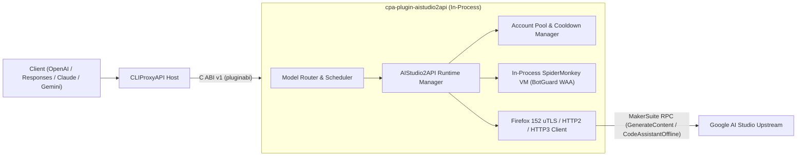

# cpa-plugin-aistudio2api (AIStudio2API for CLIProxyAPI)

<p align="center">
  <a href="./README.md">简体中文</a> | <strong>English</strong>
</p>

<p align="center">
  <a href="https://github.com/Mag1cFall/AIStudio2API"></a>
  <a href="https://github.com/router-for-me/CLIProxyAPI"></a>
  <a href="./LICENSE"></a>
</p>

> **Upstream Attribution & Acknowledgements**  
> This repository is a native **[CLIProxyAPI](https://github.com/router-for-me/CLIProxyAPI)** dynamic-library plugin port (C ABI v1 / Schema v10) of **[Mag1cFall/AIStudio2API](https://github.com/Mag1cFall/AIStudio2API)**.  
> The core Google AI Studio protocol stack (MakerSuite `GenerateContent`, Build `CodeAssistantOffline`, Firefox/uTLS fingerprint spoofing, in-process SpiderMonkey BotGuard WAA VM, multi-account cooldown scheduling, and multi-protocol translation) originates from **[Mag1cFall/AIStudio2API](https://github.com/Mag1cFall/AIStudio2API)** under the [MIT License](./LICENSE).

---

## Key Features

- **In-Process SpiderMonkey BotGuard WAA Engine**: Statically links the Firefox 152 SpiderMonkey C++ engine directly into the plugin shared library (`.dylib` / `.so` / `.dll`), executing Google BotGuard WAA bytecode and generating fresh proofs in milliseconds inside the CLIProxyAPI process—no Python, Node.js, Playwright, or headless browser required.
- **Full Playground + Build Dual-Channel Support**:
  - **Playground Channel** (`MakerSuiteService/GenerateContent`): Supports `gemini-3.8-flash`, `gemini-4-argon`, `gemini-2.5-pro`, `gemini-2.5-flash`, Imagen, Veo, TTS, and more.
  - **Build Channel** (`MakerSuiteService/CodeAssistantOffline`): Supports `-build` models (`gemini-3.8-flash-build`, `gemini-3.1-pro-preview-build`, etc.) plus Build-exclusive models (50+ models discovered automatically).
- **Native 4-Protocol Input/Output**: Accepts and streams `chat-completions` (OpenAI Chat), `responses` (OpenAI Responses), `anthropic` (Claude Messages), and `gemini` (Google Gemini Native) formats.
- **Complete CLIProxyAPI Plugin Capabilities (All 9 Interfaces)**:
  1. `auth_provider`: Supports clicking **"Start Login"** directly in the ECPA / CPA OAuth dashboard (`auth.login_start` / `auth.login_poll`) to launch an isolated local Chrome window and auto-capture credentials, syncing 1-to-1 with `~/.cli-proxy-api/aistudio2api-<email>.json`.
  2. `model_provider`: Static + per-credential dynamic discovery of Playground & Build model catalogs.
  3. `model_router`: Routes both prefixed (`aistudio/<model>`) and unprefixed (`gemini-3.8-flash`, `gemini-3.8-flash-build`) model requests.
  4. `scheduler`: Delegates to AIStudio2API's tier-aware (Paid / Free), concurrency-aware, and cooldown-aware `AccountPool`.
  5. `executor`: Synchronous & streaming generation, Build tool calling, local SentencePiece + upstream `CountTokens`, and multimodal media handling.
  6. `request_lifecycle_plugin`: Tracks request completion and upstream status codes.
  7. `quota_provider`: Reports account benefit tiers, available model counts, and cooldown recovery timers in the CPA dashboard with one-click reset.
  8. `command_line_plugin`: Adds `--aistudio2api-status` and `--aistudio2api-login` CLI flags.
  9. `management_api` + Embedded Web Console (`/v0/resource/plugins/aistudio2api/accounts`): Single-button service start/stop toggle, local isolated Chrome login, Cookie/StorageState account import, cooldown management, and live logs.
---

## Architecture



---

## Installation

### Option 1: Install from CLIProxyAPI Plugin Store (Recommended)
Open the CLIProxyAPI Management Center (or EasyCLIProxyAPI desktop app), navigate to **Plugins -> Store**, search for **`AIStudio2API`** (`aistudio2api`), and click **Install**.

### Option 2: Download Prebuilt Binary from GitHub Releases
1. Download the archive for your platform from [Releases](https://github.com/jianli9158/cpa-plugin-aistudio2api/releases):
   - macOS Apple Silicon: `aistudio2api_1.0.2_darwin_arm64.zip`
   - macOS Intel: `aistudio2api_1.0.2_darwin_amd64.zip`
   - Linux x86_64: `aistudio2api_1.0.2_linux_amd64.zip`
   - Linux ARM64: `aistudio2api_1.0.2_linux_arm64.zip`
   - Windows x86_64: `aistudio2api_1.0.2_windows_amd64.zip`
2. Extract the dynamic library (`aistudio2api.dylib` / `aistudio2api.so` / `aistudio2api.dll`) into CLIProxyAPI's plugin directory:
   ```text
   plugins/<goos>/<goarch>/aistudio2api.{dylib,so,dll}
   ```

### Option 3: Build from Source
#### Prerequisites
- Go 1.27+ with `CGO_ENABLED=1`
- C/C++ compiler (macOS: Xcode Command Line Tools; Linux: GCC/Clang; Windows: MinGW-w64 / LLVM-MinGW)

#### Build Commands
```bash
git clone https://github.com/jianli9158/cpa-plugin-aistudio2api.git
cd cpa-plugin-aistudio2api

# Automatically downloads SpiderMonkey static library and builds into dist/plugins/<goos>/<goarch>/
make build

# Run unit tests and dlopen C ABI integration tests
make test
```

---

## Configuration (`config.yaml`)

Enable the plugin in CLIProxyAPI's `config.yaml`:

```yaml
plugins:
  enabled: true
  dir: "plugins"
  configs:
    aistudio2api:
      enabled: true
      waa_backend: "spidermonkey"
      data_dir: "~/.aistudio2api"
      proxy: ""
      warm_workers: 2
      max_active_workers: 5
      per_account_concurrency: 2
      model_prefix: "aistudio/"
      route_unprefixed_models: true
      sync_auth_files: true
```

| Field | Type | Default | Description |
| :--- | :---: | :---: | :--- |
| `waa_backend` | `enum` | `"spidermonkey"` | BotGuard WAA runtime engine (in-process `"spidermonkey"` VM, no external browser needed) |
| `data_dir` | `string` | `"~/.aistudio2api"` | Directory storing internal account state, WAA cache, and model catalogs (kept outside `~/.cli-proxy-api` so internal JSON files are not scanned as credentials) |
| `proxy` | `string` | `""` | Optional upstream proxy URL (`http://`, `https://`, `socks5://`) for Google AI Studio traffic |
| `warm_workers` | `int` | `2` | Number of pre-warmed WAA workers |
| `max_active_workers` | `int` | `5` | Maximum concurrent active WAA workers |
| `per_account_concurrency` | `int` | `2` | Maximum concurrent generation requests per Google account |
| `model_prefix` | `string` | `"aistudio/"` | Model prefix routed to AIStudio2API (e.g. `aistudio/gemini-3.8-flash`) |
| `route_unprefixed_models` | `bool` | `true` | Route unprefixed AI Studio models (`gemini-3.8-flash`, `gemini-3.8-flash-build`, etc.) |
| `sync_auth_files` | `bool` | `true` | Automatically sync/remove 1-to-1 `aistudio2api-<email>.json` files in `~/.cli-proxy-api/` |
| `upstream_channels` | `[]string` | `["playground", "build"]` | Enabled upstream channels (`playground`, `build`) |
| `first_token_timeout_sec` | `int` | `20` | First-token timeout in seconds for streaming requests |
| `first_token_hedging` | `string` | `"auto"` | First-token backup request hedging policy (`auto` enables for `gemini-4-argon`, `on` for all, `off` disabled) |

---

## Account Login & Import Guide

When CLIProxyAPI starts, the plugin **automatically starts and pre-warms** in the background. You can add Google AI Studio accounts in three ways:

### Method 1: Click "Start Login" Directly in ECPA / CPA Dashboard (Easiest)
1. In EasyCLIProxyAPI (or the CLIProxyAPI Management Center), go to the **OAuth Login** or **Plugins** page, find **`AIStudio2API`**, and click **"Start Login"**.
2. The plugin immediately launches an **isolated local Chrome / Edge / Brave window** in the background (using a temporary `--user-data-dir` with Blink `AutomationControlled` disabled so it never reads your existing browser profiles or OS keychains, and passes Google Sign-In without triggering *"This browser or app may not be secure"*).
3. Sign in to your Google account and reach AI Studio; the plugin automatically captures the isolated session's credentials, closes the window, cleans up the temporary directory, and completes the login in ECPA.

### Method 2: Login or Relogin from the Embedded Plugin Console
Open the embedded plugin console (`http://127.0.0.1:8317/v0/resource/plugins/aistudio2api/accounts`, or click **Plugins -> AI Studio (WAA)** in the sidebar):
- Click **🌐 Launch Local Chrome Incognito Login** (or run `cli-proxy-api --aistudio2api-login`) to sign in via an isolated browser window;
- Click **Incognito Relogin** on any existing account row to refresh expired credentials.

### Method 3: Cookie / StorageState Import (For Headless / Remote Servers)
Paste a browser request Cookie header (containing `SAPISID` and `__Secure-1PSID`), a Cookie-Editor JSON array, or a Playwright `storage-state.json` document in the plugin console and click **Import Cookie / StorageState Account**.

---

## API Request Examples

```bash
# Playground channel model (gemini-3.8-flash)
curl http://127.0.0.1:8317/v1/chat/completions \
  -H "Authorization: Bearer YOUR_CPA_API_KEY" \
  -H "Content-Type: application/json" \
  -d '{
    "model": "gemini-3.8-flash",
    "messages": [{"role": "user", "content": "Hello!"}],
    "stream": true
  }'

# Build channel model (gemini-3.8-flash-build)
curl http://127.0.0.1:8317/v1/chat/completions \
  -H "Authorization: Bearer YOUR_CPA_API_KEY" \
  -H "Content-Type: application/json" \
  -d '{
    "model": "gemini-3.8-flash-build",
    "messages": [{"role": "user", "content": "Hello!"}],
    "stream": true
  }'
```

---

## License

Released under the **[MIT License](./LICENSE)**:
- Original project copyright: **[Mag1cFall/AIStudio2API](https://github.com/Mag1cFall/AIStudio2API)** (`Copyright (c) 2026 Mag1cFall`).
- CLIProxyAPI native plugin port copyright: `Copyright (c) 2026 jianli9158`.
